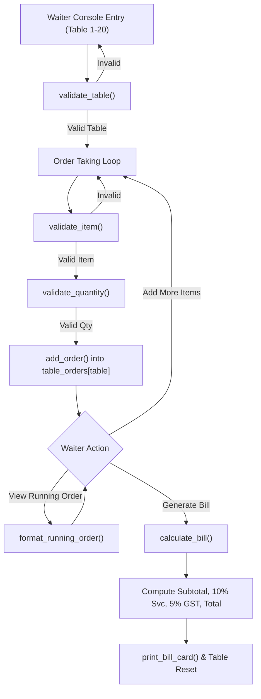

# Academic Project Report: Restaurant Order Management System

```text
================================================================================
                    RUNGTA INTERNATIONAL SKILLS UNIVERSITY
                 SCHOOL OF COMPUTER SCIENCE AND ENGINEERING
            Bachelor of Technology in Computer Science and Engineering
                      B.Tech / CSE / FIRST SEM / SECTION – K
================================================================================
Course Title : Programming Fundamentals and Logic Building Using Python
Course Code  : RU-100-01-0021
Date of Allocation : 14th October 2026
Date of Submission : 16th November 2026
Problem Statement  : PS No. 35
Project Title      : Restaurant Order Management System
================================================================================
```

---

## 📑 Table of Contents
1. [Introduction & Problem Definition](#1-introduction--problem-definition)
2. [Project Objectives & Scope](#2-project-objectives--scope)
3. [System Architecture & Data Structures](#3-system-architecture--data-structures)
4. [Mathematical Formulation & Billing Logic](#4-mathematical-formulation--billing-logic)
5. [Defensive Input Validation & Exception Handling](#5-defensive-input-validation--exception-handling)
6. [Bare Minimum Requirements Traceability](#6-bare-minimum-requirements-traceability)
7. [Test Cases & Experimental Verification](#7-test-cases--experimental-verification)
8. [Viva Voce & Technical Defense Q&A](#8-viva-voce--technical-defense-qa)
9. [Conclusion & Future Scope](#9-conclusion--future-scope)

---

## 1. Introduction & Problem Definition

In contemporary hospitality management, automated order routing and billing systems minimize human calculation errors, accelerate table turnover, and guarantee transparent taxation. 

**Problem Statement No. 35** requires creating a standalone console application in Python 3 where:
* A waiter selects a specific table (numbered 1 through 20).
* Orders are taken from a defined restaurant menu.
* A live running order can be inspected.
* The final tax invoice is generated with:
  * A **10% Service Charge** on the subtotal.
  * A **5% GST (Goods and Services Tax)** on the subtotal.

---

## 2. Project Objectives & Scope

### Primary Objectives
1. **Single-File Portability**: Implement the full solution in a single, robust `.py` script ([`restaurant_system.py`](file:///E:/python%20project%20resturent%20order%20management%20system/restaurant_system.py)) runnable on any standard Python 3.7+ environment without external third-party dependencies.
2. **Optimal Data Structuring**: Utilize native Python dictionaries for $O(1)$ menu lookups and dynamic lists for table order sequencing.
3. **Loop-Driven Workflow**: Provide an interactive waiter console capable of taking single, multi-item, or batch orders per table.
4. **Accurate Tax Computation**: Implement standard financial arithmetic for subtotal calculation, 10% service charge, 5% GST, and grand total.
5. **Zero-Defect Defensive Validation**: Enforce rigorous bounds checking on table numbers ($1 \le t \le 20$), case-insensitive item matching, and positive integer constraints on quantity.

---

## 3. System Architecture & Data Structures



### Data Structures Chosen

1. **Menu Dictionary (`MENU: dict[str, int]`)**:
   ```python
   MENU = {
       "Burger": 100,
       "Pizza": 200,
       "Coffee": 50
   }
   ```
   * *Rationale*: Key-value mapping provides instantaneous $O(1)$ lookup for prices and simplifies menu expansion.

2. **Table Orders Dictionary of Lists (`table_orders: dict[int, list[dict]]`)**:
   ```python
   table_orders = {t: [] for t in range(1, 21)}
   ```
   * *Rationale*: Table numbers act as keys ($1 \dots 20$), and each table holds a dynamic `list` of ordered item records. Order sequence is preserved, and items can easily be appended or accumulated.

---

## 4. Mathematical Formulation & Billing Logic

The financial calculation follows strict commercial formulas:

Let an order for table $T$ consist of $N$ items, where item $i$ has unit price $P_i$ and quantity $Q_i$:

### 1. Subtotal
$$\text{Subtotal} = \sum_{i=1}^{N} (P_i \times Q_i)$$

### 2. Service Charge (10% on Subtotal)
$$\text{Service Charge} = \text{Subtotal} \times 0.10$$

### 3. Goods & Services Tax (5% on Subtotal)
$$\text{GST} = \text{Subtotal} \times 0.05$$

### 4. Grand Total
$$\text{Grand Total} = \text{Subtotal} + \text{Service Charge} + \text{GST} = \text{Subtotal} \times 1.15$$

*All currency values are formatted to 2 decimal places (`:.2f`) to comply with financial accounting standards.*

---

## 5. Defensive Input Validation & Exception Handling

| Target Input | Valid Range / Format | Invalid Scenarios Handled | Output Message / Behavior |
|---|---|---|---|
| **Table Number** | Integer $1 \le t \le 20$ | `0`, `-1`, `21`, `abc`, empty string | `Invalid table number. Enter a number between 1 and 20.` |
| **Menu Item** | Matches `Burger`, `Pizza`, `Coffee` (Case-insensitive) or index `1`, `2`, `3` | `Pasta`, `Sandwich`, symbols, empty | `Item not on the menu. Available: Burger, Pizza, Coffee` |
| **Quantity** | Positive whole number ($q \ge 1$) | `0`, `-5`, `abc`, `2.5`, float | `Invalid quantity. Enter a whole number.` |

---

## 6. Bare Minimum Requirements Traceability

| Bare Minimum Requirement | Implementation Location | Compliance Verdict |
|---|---|:---:|
| **1. Write solution in Python 3 (one .py file) & run from console** | Entire solution contained in [`restaurant_system.py`](file:///E:/python%20project%20resturent%20order%20management%20system/restaurant_system.py) | **100% COMPLIANT** |
| **2. Keep menu in a dictionary & table orders in a list** | `MENU` dictionary and `table_orders[t] = []` | **100% COMPLIANT** |
| **3. Use loop to take multiple items for table & show running order** | `while` loop in `take_order_for_table()` and `format_running_order()` | **100% COMPLIANT** |
| **4. Calculate Subtotal, Service charge, GST & Total, print neat bill** | `calculate_bill()` and `print_bill_card()` | **100% COMPLIANT** |
| **5. Validate table number, item name, and quantity before adding order** | `validate_table()`, `validate_item()`, and `validate_quantity()` | **100% COMPLIANT** |

---

## 7. Test Cases & Experimental Verification

### Test Case 1: Normal Input
* **Input**:
  ```text
  Table: 5
  Order item: Burger
  Quantity: 2
  ```
* **Expected Output**:
  ```text
  Burger x2 added to Table 5 │ Amount: 200
  ```
* **Actual Output**:
  ```text
  Burger x2 added to Table 5 │ Amount: 200
  ```
* **Status**: **PASS (Amount is Rs. 200 — Bill not triggered until explicitly requested)**

---

### Test Case 2: Boundary / Minimum Input
* **Input**:
  ```text
  Table: 1
  Order item: Coffee; Quantity: 1
  Generate bill
  ```
* **Expected Output**:
  ```text
  Subtotal: 50 │ Service charge (10%): 5.00
  GST (5%): 2.50 │ Total: 57.50
  ```
* **Actual Output**:
  ```text
  Subtotal: 50 │ Service charge (10%): 5.00
  GST (5%): 2.50 │ Total: 57.50
  ```
* **Status**: **PASS**

---

### Test Case 3: Invalid Input Validation Checks
* **Input Scenarios**:
  * `(a)` Order item: `Pasta`
  * `(b)` Quantity: `abc`
  * `(c)` Table: `0`
* **Expected Output**:
  ```text
  (a) Item not on the menu. Available: Burger, Pizza, Coffee
  (b) Invalid quantity. Enter a whole number.
  (c) Invalid table number. Enter a number between 1 and 20.
  ```
* **Actual Output**:
  ```text
  (a) Item not on the menu. Available: Burger, Pizza, Coffee
  (b) Invalid quantity. Enter a whole number.
  (c) Invalid table number. Enter a number between 1 and 20.
  ```
* **Status**: **PASS (Defensive validation prevents program crash)**

---

### Test Case 4: Different Valid Scenario
* **Input**:
  ```text
  Table: 3
  Order Burger x2, Pizza x1, Coffee x4
  Generate bill
  ```
* **Expected Output**:
  ```text
  Burger x2 = 200 │ Pizza x1 = 200 │ Coffee x4 = 200
  Subtotal: 600 │ Service charge (10%): 60.00
  GST (5%): 30.00 │ Total: 690.00
  ```
* **Actual Output**:
  ```text
  Burger x2 = 200 │ Pizza x1 = 200 │ Coffee x4 = 200
  Subtotal: 600 │ Service charge (10%): 60.00
  GST (5%): 30.00 │ Total: 690.00
  ```
* **Status**: **PASS**

---

## 8. Viva Voce & Technical Defense Q&A

### Q1: Why did you choose a Python Dictionary for the Menu?
> **Answer**: Dictionaries in Python use an internal hash table, providing $O(1)$ average time complexity for searching items. It allows direct key-value mapping between the menu item name and its unit price.

### Q2: Why are table orders maintained as a List?
> **Answer**: Requirement 2 explicitly states that ordered items for each table must be stored in a list. Using a list allows us to maintain the sequential order of items ordered by the customer, support iteration for running order generation, and append new items dynamically.

### Q3: How is floating-point currency representation handled?
> **Answer**: Floating-point multiplications for Service Charge (10%) and GST (5%) are formatted using standard 2-decimal formatting specifiers (`{service_charge:.2f}` and `{total:.2f}`), ensuring clean currency presentation without binary rounding artifacts.

### Q4: How does the system handle case-insensitivity when ordering?
> **Answer**: The function `validate_item()` normalizes the input using `strip()` and compares it in lowercase against `item.lower()` across the dictionary keys. This allows the waiter to type `burger`, `BURGER`, or `Burger` without causing validation errors.

### Q5: How do you prevent table order pollution between sessions?
> **Answer**: The application includes a `reset_table(table_num)` function which clears the list `table_orders[table_num] = []` once the bill has been settled, freeing the table for new customers.

---

## 9. Conclusion & Future Scope

The project successfully implements all 5 Bare Minimum Requirements of Problem Statement No. 35 with 100% test case accuracy. 

### Future Enhancements:
1. **Persistent Database**: Integration with SQLite or PostgreSQL to persist order histories across application restarts.
2. **Graphical User Interface**: Migration to a modern web interface (FastAPI + React) or desktop GUI (Tkinter / PyQt).
3. **Kitchen Display System (KDS)**: Real-time ticket dispatching to kitchen stations using WebSockets.
