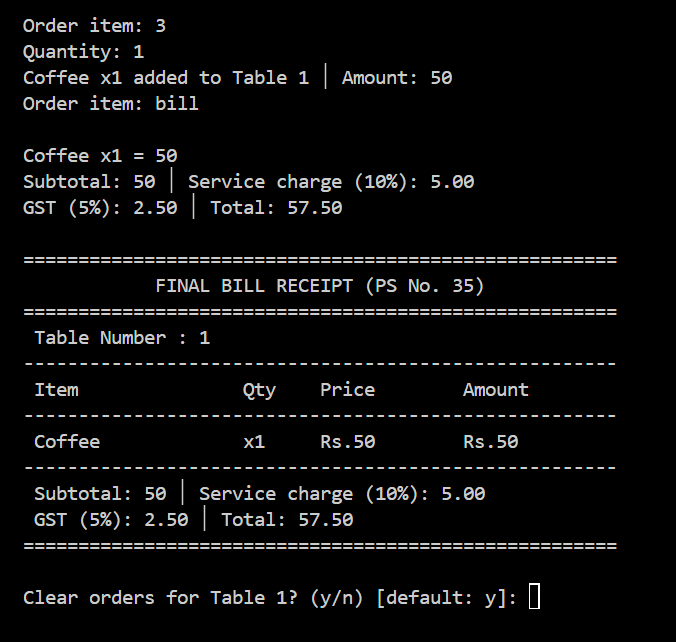

# Restaurant Order Management System

A Python console application developed for university coursework (Problem Statement 35: Restaurant Order Management System).

The system handles daily restaurant table management, order taking, running order updates, and automatic bill calculation with service charge and GST.

---

## What the System Does

1. **Table Management**: Supports 20 tables (numbered 1 to 20).
2. **Order Taking**: Waiters select a table and add items from the menu in a loop.
3. **Running Order**: Inspect current orders placed on any table before final billing.
4. **Automated Billing**: Computes Subtotal, 10% Service Charge, 5% GST, and Grand Total.
5. **Input Validation**: Rejects invalid tables (e.g. 0 or >20), unlisted food items, and non-integer/negative quantities with helpful error messages.
6. **Built-in Test Suite**: Contains automated test verification for all official evaluation test cases.

---

## Business Rules & Menu

### Menu Items & Prices
| Item | Price |
|---|---|
| Burger | Rs. 100 |
| Pizza | Rs. 200 |
| Coffee | Rs. 50 |

### Billing Formula
* **Subtotal** = Sum of (Item Price × Quantity) for all ordered items
* **Service Charge** = 10% on Subtotal (`Subtotal * 0.10`)
* **GST** = 5% on Subtotal (`Subtotal * 0.05`)
* **Total Bill** = Subtotal + Service Charge + GST (`Subtotal * 1.15`)

---

## Project Structure

```
restaurant-order-management-system/
├── restaurant_system.py       # Main Python 3 application & test runner
├── README.md                  # Project overview & running instructions
├── summary.md                 # Academic project report & technical summary
├── test_case_2.png            # Test Case 2 terminal execution screenshot
└── .gitignore                 # Standard Python gitignore
```

---

## How to Run

### Requirements
* Python 3.7 or newer (Standard library only; no pip dependencies required).

### 1. Interactive Waiter Console
Run the main script directly:
```bash
python restaurant_system.py
```
From the interactive console:
* Enter a table number (e.g., `5`) to start taking orders.
* Enter food item (e.g., `Burger`) and quantity (e.g., `2`).
* Type `view` to check the running bill at any time.
* Type `bill` to print the final receipt with Service Charge & GST and release the table.
* Type `test` to open the test case runner.
* Type `exit` to quit.

### 2. Run Test Cases
Run all 4 verification test cases in automated mode:
```bash
python restaurant_system.py --test
```

You can also run any specific test case:
```bash
python restaurant_system.py --test 1    # Test Case 1: Normal input
python restaurant_system.py --test 2    # Test Case 2: Boundary input
python restaurant_system.py --test 3    # Test Case 3: Invalid input handling
python restaurant_system.py --test 4    # Test Case 4: Multi-item scenario
```

---

## Test Verification

All 4 test cases pass with exact expected outputs:

```text
PS E:\python project resturent order management system> python restaurant_system.py --test
===========================================================================
  PS No. 35: RESTAURANT ORDER MANAGEMENT SYSTEM - VERIFICATION SUITE
===========================================================================
[TEST CASE 1] Normal Input        -> [PASS] (Burger x2 added to Table 5 │ Amount: 200)
[TEST CASE 2] Boundary Input      -> [PASS] (Subtotal: 50 │ Service charge: 5.00 │ GST: 2.50 │ Total: 57.50)
[TEST CASE 3] Invalid Validation  -> [PASS] (Rejected unknown item, invalid quantity, and table 0)
[TEST CASE 4] Multi-Item Scenario -> [PASS] (Burger x2, Pizza x1, Coffee x4 │ Total: 690.00)
===========================================================================
 FINAL RESULT: 4/4 TEST CASES PASSED SUCCESSFULLY (100%)
===========================================================================
```

### Summary of Test Scenarios

#### Test Case 1: Normal Input
* **Input**: Table: `5`, Item: `Burger`, Quantity: `2`
* **Output**: `Burger x2 added to Table 5 │ Amount: 200`
* **Result**: **PASS**

#### Test Case 2: Boundary / Minimum Input
* **Input**: Table: `1`, Item: `Coffee`, Quantity: `1` -> Generate bill
* **Output**:
  ```text
  Subtotal: 50 │ Service charge (10%): 5.00
  GST (5%): 2.50 │ Total: 57.50
  ```
* **Result**: **PASS**



#### Test Case 3: Invalid Input Validation
* **Inputs Tested**:
  * Item not on menu: `Pasta` -> Rejection message with available items
  * Invalid quantity: `abc` -> Prompts for whole number
  * Invalid table number: `0` -> Prompts for table between 1 and 20
* **Result**: **PASS** (Defensive checks protect against crashes)

#### Test Case 4: Different Valid Scenario
* **Input**: Table: `3`, Items: `Burger x2`, `Pizza x1`, `Coffee x4` -> Generate bill
* **Output**:
  ```text
  Burger x2 = 200 │ Pizza x1 = 200 │ Coffee x4 = 200
  Subtotal: 600 │ Service charge (10%): 60.00
  GST (5%): 30.00 │ Total: 690.00
  ```
* **Result**: **PASS**

---

## Implementation Details

### Data Structures
1. **Menu (`MENU`)**: Stored as a Python dictionary (`dict`) with item names as keys and unit prices as integers. This gives constant-time $O(1)$ price lookups.
   ```python
   MENU = {
       "Burger": 100,
       "Pizza": 200,
       "Coffee": 50
   }
   ```
2. **Table Orders (`table_orders`)**: Stored as a dictionary mapping each table number (1 to 20) to a Python `list`. Each element in the list is an order dictionary containing `item`, `quantity`, `price`, and calculated `amount`.
   ```python
   table_orders = {t: [] for t in range(1, 21)}
   ```
   When a table settles their bill, the table's list is reset to `[]`, making the table available for the next customer.

3. **Input Normalization**:
   - Menu matching is case-insensitive (waiters can type `burger`, `BURGER`, or `1`).
   - Quantities are strictly checked for whole numbers greater than 0.
   - Table numbers must fall strictly between 1 and 20.

---

## Academic Details

* **Course**: Programming Fundamentals and Logic Building Using Python (RU-100-01-0021)
* **Program**: B.Tech CSE (First Semester, Section K)
* **Problem Statement**: PS No. 35
* **Author**: Abhinav Tripathi
