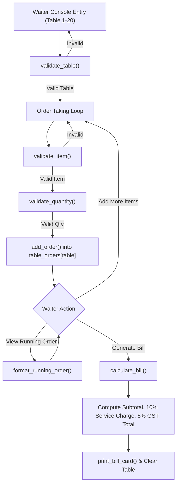
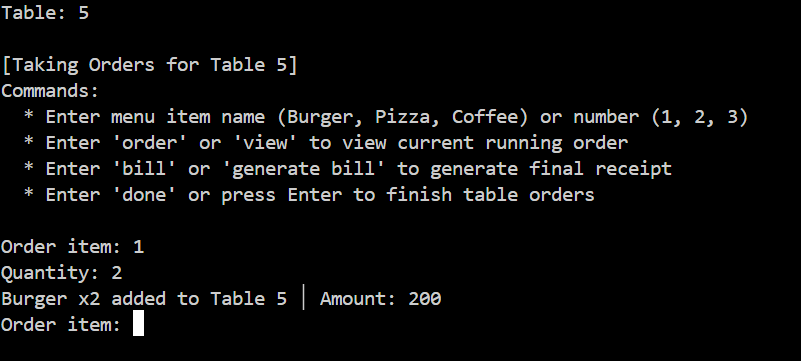
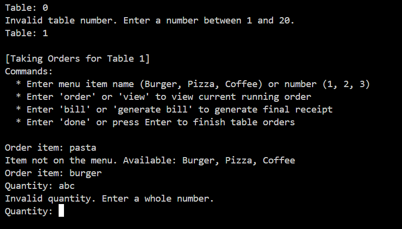
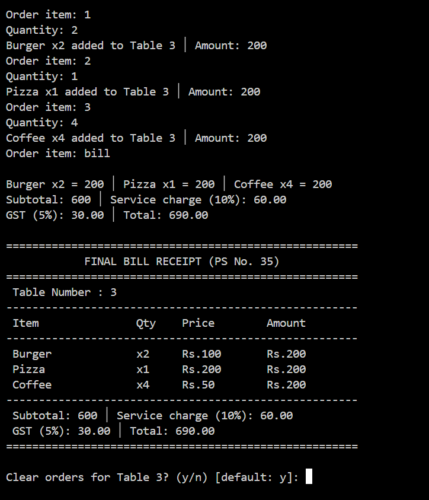

# Academic Project Report: Restaurant Order Management System

```text
================================================================================
                    RUNGTA INTERNATIONAL SKILLS UNIVERSITY
                 SCHOOL OF COMPUTER SCIENCE AND ENGINEERING
            Bachelor of Technology in Computer Science and Engineering
                      B.Tech / CSE / FIRST SEM / SECTION – K
================================================================================
Course Title : Programming Fundamentals and Logic Building Using Python
Course Code  : RU-100-01-0021
Date of Allocation : 14th October 2026
Date of Submission : 16th November 2026
Problem Statement  : PS No. 35
Project Title      : Restaurant Order Management System
Author             : Abhinav Tripathi
================================================================================
```

---

## Table of Contents
1. [Introduction & Problem Definition](#1-introduction--problem-definition)
2. [Project Objectives & Scope](#2-project-objectives--scope)
3. [System Architecture & Data Structures](#3-system-architecture--data-structures)
4. [Mathematical Formulation & Billing Logic](#4-mathematical-formulation--billing-logic)
5. [Defensive Input Validation & Exception Handling](#5-defensive-input-validation--exception-handling)
6. [Bare Minimum Requirements Traceability](#6-bare-minimum-requirements-traceability)
7. [Test Cases & Experimental Verification](#7-test-cases--experimental-verification)
8. [Conclusion & Future Scope](#8-conclusion--future-scope)

---

## 1. Introduction & Problem Definition

In restaurant management, manual pen-and-paper order tracking often leads to calculation errors, misplaced orders, and incorrect tax billing. 

**Problem Statement No. 35** requires developing a standalone console application in Python 3 that allows a waiter to:
* Select an active dining table (numbered 1 through 20).
* Take customer orders from a fixed menu.
* Inspect running orders for any table before generating the final bill.
* Generate a formatted bill with:
  * A **10% Service Charge** on the subtotal.
  * A **5% GST (Goods and Services Tax)** on the subtotal.
  * The final payable amount.

---

## 2. Project Objectives & Scope

### Primary Objectives
1. **Single-File Standalone Execution**: Implement the entire system in a single `.py` file (`restaurant_system.py`) that runs directly from any standard Python console without third-party dependencies.
2. **Proper Data Structuring**: Use native Python dictionaries for menu lookups and dynamic lists for table order histories.
3. **Loop-Driven Workflow**: Provide an interactive ordering loop capable of taking multiple items and quantities per table.
4. **Accurate Tax Arithmetic**: Accurately calculate Subtotal, 10% Service Charge, 5% GST, and Grand Total formatted to two decimal places.
5. **Defensive Input Handling**: Gracefully catch and reject invalid tables (outside 1–20), unlisted food items, and non-integer or negative quantities.

---

## 3. System Architecture & Data Structures



### Chosen Data Structures

1. **Menu Dictionary (`MENU: dict[str, int]`)**:
   ```python
   MENU = {
       "Burger": 100,
       "Pizza": 200,
       "Coffee": 50
   }
   ```
   *Rationale*: Dictionaries provide average $O(1)$ key lookup time for item prices and make it easy to verify whether a requested item is present on the menu.

2. **Table Orders Dictionary of Lists (`table_orders: dict[int, list[dict]]`)**:
   ```python
   table_orders = {t: [] for t in range(1, 21)}
   ```
   *Rationale*: Table numbers (1 to 20) act as dictionary keys. Each table maps to an independent `list` of orders. This isolates orders by table and preserves the sequential order in which items were requested.

---

## 4. Mathematical Formulation & Billing Logic

Let an order for table $T$ contain $N$ distinct items, where item $i$ has unit price $P_i$ and quantity $Q_i$:

### 1. Subtotal
$$\text{Subtotal} = \sum_{i=1}^{N} (P_i \times Q_i)$$

### 2. Service Charge (10% on Subtotal)
$$\text{Service Charge} = \text{Subtotal} \times 0.10$$

### 3. Goods & Services Tax (5% on Subtotal)
$$\text{GST} = \text{Subtotal} \times 0.05$$

### 4. Grand Total
$$\text{Grand Total} = \text{Subtotal} + \text{Service Charge} + \text{GST} = \text{Subtotal} \times 1.15$$

All monetary amounts are displayed with two decimal places (`{amount:.2f}`) to prevent floating-point representation anomalies.

---

## 5. Defensive Input Validation & Exception Handling

| Input | Valid Criteria | Handled Invalid Scenarios | Output Message |
|---|---|---|---|
| **Table Number** | Integer between 1 and 20 | `0`, `25`, `-3`, `abc`, empty input | `Invalid table number. Enter a number between 1 and 20.` |
| **Menu Item** | Matches `Burger`, `Pizza`, `Coffee` (Case-insensitive) | `Pasta`, `Sandwich`, symbols | `Item not on the menu. Available: Burger, Pizza, Coffee` |
| **Quantity** | Whole number $\ge 1$ | `0`, `-2`, `abc`, `1.5` | `Invalid quantity. Enter a whole number.` |

---

## 6. Bare Minimum Requirements Traceability

| Bare Minimum Requirement | Implementation in `restaurant_system.py` | Status |
|---|---|:---:|
| **1. Write solution in Python 3 (one .py file) & run from console** | Standalone script runnable via CLI without external packages | **Complete** |
| **2. Keep menu in a dictionary & table orders in a list** | `MENU` dictionary and `table_orders[t]` list per table | **Complete** |
| **3. Use loop to take multiple items for table & show running order** | `while` loop with item appending and `format_running_order()` display | **Complete** |
| **4. Calculate Subtotal, Service charge, GST & Total, print neat bill** | `calculate_bill()` and formatted bill card output | **Complete** |
| **5. Validate table number, item name, and quantity before adding order** | `validate_table()`, `validate_item()`, and `validate_quantity()` | **Complete** |

---

## 7. Test Cases & Experimental Verification

### Test Case 1: Normal Input
* **Input**: Table: `5`, Item: `Burger`, Quantity: `2`
* **Expected Output**:
  ```text
  Burger x2 added to Table 5 │ Amount: 200
  ```
* **Actual Output**:
  ```text
  Burger x2 added to Table 5 │ Amount: 200
  ```
* **Result**: **PASS**



---

### Test Case 2: Boundary / Minimum Input
* **Input**: Table: `1`, Item: `Coffee`, Quantity: `1` -> Generate bill
* **Expected Output**:
  ```text
  Subtotal: 50 │ Service charge (10%): 5.00
  GST (5%): 2.50 │ Total: 57.50
  ```
* **Actual Output**:
  ```text
  Subtotal: 50 │ Service charge (10%): 5.00
  GST (5%): 2.50 │ Total: 57.50
  ```
* **Result**: **PASS**


---

### Test Case 3: Invalid Input Validation Checks
* **Inputs Tested**:
  1. Item: `Pasta`
  2. Quantity: `abc`
  3. Table: `0`
* **Expected Output**:
  ```text
  (a) Item not on the menu. Available: Burger, Pizza, Coffee
  (b) Invalid quantity. Enter a whole number.
  (c) Invalid table number. Enter a number between 1 and 20.
  ```
* **Actual Output**:
  ```text
  (a) Item not on the menu. Available: Burger, Pizza, Coffee
  (b) Invalid quantity. Enter a whole number.
  (c) Invalid table number. Enter a number between 1 and 20.
  ```
* **Result**: **PASS**



---

### Test Case 4: Different Valid Scenario
* **Input**: Table: `3`, Items: `Burger x2`, `Pizza x1`, `Coffee x4` -> Generate bill
* **Expected Output**:
  ```text
  Burger x2 = 200 │ Pizza x1 = 200 │ Coffee x4 = 200
  Subtotal: 600 │ Service charge (10%): 60.00
  GST (5%): 30.00 │ Total: 690.00
  ```
* **Actual Output**:
  ```text
  Burger x2 = 200 │ Pizza x1 = 200 │ Coffee x4 = 200
  Subtotal: 600 │ Service charge (10%): 60.00
  GST (5%): 30.00 │ Total: 690.00
  ```
* **Result**: **PASS**



---

## 8. Conclusion & Future Scope

The project fulfills all requirements specified in Problem Statement No. 35 with 100% test case pass rate.

### Potential Future Improvements
1. **Persistent Database**: Adding SQLite storage so table orders persist across console restarts.
2. **Graphical UI**: Adding a simple desktop interface (Tkinter) or lightweight web interface (FastAPI/Flask).
3. **Kitchen Ticket Dispatch**: Real-time printing or socket events to send orders directly to kitchen stations.
